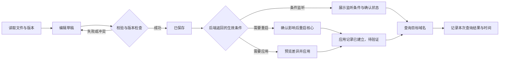

# LovestDNS 交互、UI 与程序实现审查、优化方案

审查日期：2026-11-06。对象：当前工作区的 LovestDNS `0.1.0-dev.lovestdns-native.20261104.16` 界面，包含本地尚未提交的改动。

建议先完成“状态可信、编辑可靠、下一步明确”，再统一布局和视觉。现有导航、卡片、主题与基础防误操作机制可以保留，主要工作集中在编辑流程、反馈状态和信息排序。

补充程序审查：后端写入一致性、维护任务幂等和执行器健康应与前端可靠性一同优先处理；详细证据、架构建议和合并排期见第 9–14 节。第 6 节的工作量仅覆盖原交互/UI 范围。

执行记录：用户已授权实施，下方第 1–14 节保留审查时的发现与建议；实际落地内容、验证和边界见第 15 节。

## 1. 审查范围与证据

- 阅读当前 `integrated/frontend/src` 的全部导航页面、认证入口、配置编辑、历史恢复、维护任务及状态刷新逻辑；结合对应后端保存、生效条件实现核对。
- 重新组装当前覆盖层，TypeScript、Vite 构建、ESLint 及独立版 39 个文件冻结校验通过。
- 使用仅监听本机、禁止写接口的独立预览，数据为合成样例。检查桌面配置中心、TTL 页面，以及 390 × 844 视口下的九个主页面。
- 浏览器复现“编辑模式切换产生修改”和“主动暂停后显示采集异常”；对移动端溢出与操作位置读取 DOM 尺寸。
- 本轮没有修改产品代码，没有执行真实 DNS 查询、保存生产配置、重启核心、恢复历史或调整外部 API 权限。认证失效草稿问题来自代码路径核查，未在生产会话中触发。

证据标记：**实测** = 本轮浏览器观察；**代码** = 当前实现直接支持；**建议** = 基于使用流程提出的设计判断，尚需实施后验证。

## 2. 优先处理的问题

P1：影响编辑可靠性、关键操作或状态判断，优先修复。P2：影响操作效率、理解成本和一致性，随后优化。

| 编号 | 优先级 | 问题与影响 | 建议 | 证据 |
| --- | --- | --- | --- | --- |
| U01 | P1 | 会话失效后切换登录页会卸载编辑页面；草稿主要存在页面 state，离开提醒只登记 dirty 布尔值，无法恢复内容 | 将草稿提升到认证界面外的会话级存储；重新登录后恢复，重新校验磁盘版本 | 代码 |
| U02 | P1 | 分流列表只切换文本/可视化模式就变成“有未保存修改”，切回后原文末尾换行消失；解析器也丢弃空行 | 保留原始文档及行映射；未实际编辑时直接使用原文，模式切换不得改写内容 | 实测 + 代码 |
| U03 | P1 | 主动暂停刷新超过 25 秒后，运行值被清空，同时出现“采集暂不可用”“等待采集器”等提示，用户容易误判服务故障 | 分离“用户暂停”“数据过期”“请求失败”“核心异常”；暂停时保留带时间的历史快照，停止宣称当前健康 | 实测 + 代码 |
| U04 | P1 | 390px 宽 TTL 页面被说明表撑至约 603px，示例被裁切、说明挤成窄列；保存按钮距文档顶部约 1287px | 编辑区和状态前置；说明默认折叠；表格局部滚动或移动端改为格式卡片 | 实测 |
| U05 | P2 | 保存成功、应用条件、下一步分别出现在顶栏、Toast、页底说明及配置中心，用户需要跨页重新判断 | 统一当前文件状态条，集中显示结果和唯一的下一步主操作 | 代码 + 建议 |
| U06 | P2 | 基础设置和高级配置都编辑 `custom_env.ini`，文件与业务名称之间缺少明确关联 | 基础设置提供“表单 / 源文件”入口；高级配置中原入口解释“与基础设置为同一文件”并复用草稿 | 代码 + 建议 |
| U07 | P2 | 配置中心同时呈现重启与预览应用，缺少针对当前文件的推荐；版本明细占据应用操作前方 | 首屏展示待处理文件摘要及推荐动作，细节按需展开，保留原生/容器差异 | 实测 + 代码 |
| U08 | P2 | 分流页手机端五个分类并排压缩，“强制转发”等标签变成逐字竖排；优先级说明占据大块首屏 | 分类改为不换行横向标签或选择器；长优先级说明收进帮助区 | 实测 |
| U09 | P2 | 状态页先展示全部组件说明，再展示查询趋势；样例下手机端首个趋势标题距顶部约 2058px | 关键指标和异常摘要前置，趋势其次，正常组件与技术说明折叠 | 实测 + 建议 |
| U10 | P2 | 异常组件的日志链接只到维护页，默认组件仍为 bootstrap；编辑后的验证入口也不携带目标域名 | 保留组件、文件、可验证域名等上下文，进入目标工具后预填，执行仍由用户触发 | 代码 |
| U11 | P2 | 通用保存按钮未使用 dirty 禁用无变化保存；基础设置却已使用，两种行为不同；部分成功文案在继续编辑后仍保留 | 统一按钮规则与反馈有效期；再次编辑后突出“新的修改未保存” | 代码 |
| U12 | P2 | 大量辅助信息为 10–11px；顶栏常驻修改密码/退出图标，手机端密集；普通信息也使用警示图标 | 建立字号、间距、颜色、消息和触控尺寸规范；账户操作收进菜单 | 实测 + 代码 |
| U13 | P2 | 诊断结果逐块堆叠，比较时缺少结论摘要；技术标记默认展开；重新查询立即清空旧报告 | 先给结果摘要与差异，再展开记录和技术细节；查询中保留标明时间的上次结果 | 代码 + 建议 |

### U01：草稿生命周期需要覆盖重新登录

当前 `/api` 请求返回 401 会触发会话检查，`App` 在未认证时返回登录页，原 `SuiteProvider` 和编辑页随之卸载。`useUnsavedChanges` 仅记录布尔值，不能保存编辑内容。现有“连接中断，草稿已保留”适用于仍挂载页面的连接失败，不能扩展为所有登录失效场景的保证。

补充核对：复用的旧 store 已将部分文件内容和 custom_mod 可视化条目写入 localStorage，但它没有同步保存所有编辑器的原文、版本和 dirty 状态，也没有完整的重新登录恢复流程。因此“部分内容已持久化”不能视为可靠草稿恢复；详见 P06。

第一步将每个文件的原始版本、草稿、dirty、编辑模式放到认证分支之外的内存层，按实例和文件隔离。登录过期用覆盖层处理，明确说明重新登录后可继续。主动退出登录清除内存草稿。

如后续需要浏览器刷新后恢复，再提供明确可选的本机草稿功能，设置过期时间与清理入口。不要顺手把配置、密码或 Token 全部写入 localStorage。重新登录或恢复草稿后必须重新读取服务器 revision，发现冲突时保留两份内容供合并。

### U02：切换模式应当是视图切换

本轮最小复现：读取 `domain:example.com\n` → 点击“可视化编辑” → 未修改规则便出现未保存提示 → 点击“文本编辑”，内容变为 `domain:example.com`。

建议沿用当前 `customEnvEditor` 保留原文的思路，建立规则对应的源行位置；无编辑返回原文，有编辑只修改受影响行。注释、空行、顺序、换行符和末尾换行均属于需要保留的文档信息。TTL 的生成器也会重建说明头，应一并覆盖“仅切换视图”的回归场景。

遇到无法无损解释的内容时，保留文本编辑并说明具体限制。不要仅靠比较序列化后的字符串判断用户是否修改。

### U03：暂停与故障分开表达

本轮复现：服务正常 → 暂停自动刷新 → 超过样本有效期 → 更新时间变为“未采集”，组件、内存等值消失，出现两条采集相关提示。

建议显示：“已暂停 · 以下为 15:20:05 的快照 · 继续刷新”。历史数值可以保留，但颜色和文字必须明确其非实时性质。连接失败时则显示“连接失败 · 最后成功采集于 … · 重试”。真实组件异常单独列出组件、影响和日志入口。

全局暂停状态应在所有页面可见；明确它控制运行指标，而配置版本和维护任务可以按各自规则继续刷新。顶栏“刷新”命名为“刷新运行状态”，文件操作统一叫“重新读取文件”，避免误以为顶栏刷新能解决配置读取问题。

## 3. 目标操作流程

### 配置：一个文件、一条状态线、一个明确的下一步

保留保存、应用、验证之间真实的业务区别。建议所有编辑页使用相同状态模型和展示位置：



状态文案建议：

| 状态 | 界面文案 | 主操作 |
| --- | --- | --- |
| 未修改 | 已读取，暂无修改 | 保存禁用 |
| 草稿已改变 | 有未保存修改 | 保存当前文件 |
| 保存失败 | 保存失败，草稿保留 | 修正并重试 |
| 文件有冲突 | 服务器文件已更新，草稿保留 | 查看差异与合并 |
| 已保存、需重启 | 已保存，待重启 DNS 核心 | 查看影响并重启 |
| 已保存、需应用 | 已保存，待应用自定义规则 | 预览并应用 |
| 条件监听文件 | 已保存，监听条件：已满足 / 未满足 / 待确认 | 验证域名 / 查看所需设置 |
| 任务完成 | 应用任务已完成，解析效果待验证 | 验证目标域名 |
| 无当前确认记录 | 当前进程尚无应用确认记录 | 查看详情 / 查询验证 |
| 查询完成 | 此域名、此记录类型在此时间的查询结果 | 查看结果 / 返回编辑 |

“无确认记录”不能直接变成“配置未生效”。监听条件满足不代表已经确认自动加载；单个域名查询成功也不能标记所有规则验证通过。

保存结果只在状态条保留一份详细内容；Toast 如保留，仅提示简短事件。当前文件又有修改时，之前的成功结果降为历史记录。应保留现有 expected revision、预览哈希和任务 request ID 机制。

保存后直接在当前页给出后续入口，可打开复用的应用面板；重启仍展示影响和确认。配置中心汇总所有文件状态，但不提供无依据的“一键全部生效”。容器版继续显示宿主机操作路径。

### 故障排查：把问题上下文带到下一页

“数据更新失败 → 查看日志”应直接选择 updater 日志。“某域名分流规则 → 验证”应带入该域名与记录类型，并允许修改。正则或关键字规则无法确定一个域名时，先让用户填写测试域名。

查询结果顶部用简明摘要呈现状态、回答记录数、耗时、目标服务器和协议；链路对照使用并列表格突出结果或耗时差异。NOERROR 无目标记录、NXDOMAIN、超时、连接拒绝应有不同说明，不能仅用同一种红色“失败”代替。

日志页在选定组件后读取日志，展示最后读取时间，并提供复制、下载、文本过滤和重试。来自异常卡片时自动读取相应组件；日常日志入口仍可手动选组件。继续保持现有有界行数和后端脱敏。

## 4. 页面布局方案

### 服务状态

从上至下调整为：

1. **服务结论和新鲜度**：核心是否运行、何时采集、是否暂停；异常摘要附处理入口。
2. **关键指标**：直接解析 QPS、上游转发 QPS、两路缓存命中率摘要、Redis 内存；明确统计范围，不合成为入口总 QPS。
3. **趋势**：查询趋势和缓存趋势；显示最近值、时间范围和“当前会话采样”。完整指标不重复占用多张大卡。
4. **组件状态**：异常优先、正常折叠；技术名称和进程信息进入详情。
5. **持久化详情**：上次快照、未落盘变更等放在缓存区；运行正常时不抢占主要趋势位置。

手机端短指标可用两列，长说明卡使用一列；正常组件收成摘要。保持 5 秒采集节奏与断线不连线等既有正确行为，不新增没有后端数据来源的历史时段选择器。

### 配置中心

从“操作目录 + 多块说明”调整为“配置与应用工作台”：顶部显示当前待处理状态及相应动作，接着是分类入口和最近任务。完整版本明细、历史恢复按需展开。

应用面板优先用业务名称，如“基础设置（custom_env.ini）”“自定义解析（custom_mod.yaml）”。预览先显示输入文件、变化摘要与影响，生成文本和哈希放在技术详情中。若后端尚未提供可靠的字段级差异，先展示文件级差异，不能推测具体生效结果。

### 基础设置

保留现有搜索与分组跳转。将“覆盖服务启动设置”表达为更明确的“使用启动设置 / 使用自定义值”，同时展示运行值、已保存目标值和未保存草稿之间的区别。设置校验失败时定位到具体字段，提供错误文案与有效范围。

依赖 CNAUTO 的设置显示“需开启智能分流”，附直接定位入口；相关草稿值保留，不静默清空。运行值读取失败时统一显示未知，其他页面也不能把 store 中的旧值当作最新值推断条件。

### 域名分流与 TTL

建议统一结构：

```text
域名分流 / TTL 规则                      帮助
当前分类、启用条件、规则数量
当前文件状态                     [保存当前文件]
搜索规则                  [+ 添加规则] [更多]
规则编辑区                  [可视化 | 文本]
当前结果与下一步                 [验证目标域名]
▸ 匹配优先级、语法、示例
```

分流分类手机端使用单行不换行标签并支持局部横向滚动，或使用当前分类选择器，避免每个分类压成窄列。输入域名时提供“包含子域名 / 精确匹配”等中文含义，技术前缀放到补充信息中。

可视化行保留“启用、编辑”等高频操作，将移动、插入注释等次级操作放进菜单；删除当前草稿行后提供撤销。大列表优先增加搜索、命中数量和定位，再依据真实数据规模评估虚拟列表。

TTL 规则需要醒目显示当前 RULES_TTL 值、是否依赖智能分流、是否待应用。页面名称或副标题可补充“域名转发与 TTL”，避免用户以为每条规则都能设置独立 TTL。

### 高级配置、维护与服务信息

高级配置按业务含义展示“环境变量源文件 / 自定义解析 / Unbound 配置”，文件名作为副标题。原文预览默认折叠；若原文与输入相同，不重复完整展示。保留未知语法保护并补齐无损编辑边界。

维护页先显示正在执行或失败的任务与对应日志，Redis 快照等操作放在维护区；实例版本信息集中到服务信息，减少重复。服务信息使用“实例 / 外部 API / 主机操作”分区，复制命令后给出成功或失败反馈。

第一轮保留现有九个导航入口和旧 hash 路径。仅明确“配置中心”的汇总与应用职责，并打通共享文件入口；不同时进行大规模路由合并，以降低迁移成本。

## 5. UI 规范建议

| 项目 | 建议目标 |
| --- | --- |
| 视觉方向 | 延续当前浅底、深色文字和橙色主操作；深色模式保持同样的信息层级 |
| 颜色职责 | 橙色用于主操作和选中；成功、警告、错误、信息使用独立语义色及文字；普通说明使用信息图标 |
| 字号 | 正文和表单标签以 14px 为主，辅助说明通常不低于 12px；手机输入文字以 16px 为目标，验证实际浏览器表现 |
| 控件 | 桌面主控件约 36–40px 高；手机主要点击区域目标至少 44 × 44px，包含透明留白面积 |
| 间距 | 使用 4/8/12/16/24/32 的统一间距层级，减少卡片内再套多层大卡片 |
| 主次 | 每个操作区一个突出主按钮；下载、复制、语法帮助降为次级操作 |
| 页面标题 | 精简重复品牌眉题、面包屑与副标题，保留页面名和必要状态 |
| 顶栏 | 运行状态刷新保留；修改密码、退出登录收进账户菜单，主题入口可独立或进入菜单 |
| 手机固定条 | 复用现有 sticky 操作条；缩短文件名显示，完整名称可查看；验证软键盘、滚动定位和内容遮挡 |
| 反馈 | 加载用局部占位；错误出现在产生错误的控件附近；长操作显示当前阶段，只有后端提供进度时才显示百分比 |
| 可访问性 | 补齐文本编辑器名称、图标按钮名称、选项卡语义、字段错误关联；保留导航焦点限制、Esc 关闭和状态文本 |

这些数值是本项目的设计目标；本轮未完成屏幕阅读器、色彩对比度或真实手机软键盘的完整验收。

实现时收敛 `suite.css` 中重复的媒体查询和覆盖规则，抽出颜色、字号、控件高度等语义变量。当前 `--suite-blue` 已实际承担橙色品牌色，应改成可理解的语义名称并集中映射。改动只进入当前覆盖层，继续保持冻结版不变。

## 6. 实施顺序与工作量

估算前提：一名熟悉当前 React/Flask 项目的开发者，沿用现有 API，不新增查询日志采集、历史指标存储或 DNS 核心功能。以下为人日估算，正式排期应在拆任务后确认。

| 批次 | 范围 | 预期交付 | 估算 |
| --- | --- | --- | --- |
| 第一批：可靠性与手机阻碍 | U01–U04，分流分类换行，无修改保存及旧反馈清理 | 草稿可续接、模式无副作用、暂停语义准确、规则页无整页横向溢出 | 3–5 人日 |
| 第二批：任务流程 | 统一文件状态条、配置工作台、上下文跳转、字段错误定位、日志入口 | 用户能连续完成编辑、保存、应用、验证，异常有直接处理路径 | 4–6 人日 |
| 第三批：布局与一致性 | 状态页排序、诊断摘要、编辑器密度、主题与控件规范、辅助功能 | 桌面与移动端统一的信息层级和组件表现 | 3–4 人日 |

总计约 10–15 人日，包含相关回归与视觉核对。若仅做最小优化包，可先处理第一批中模式切换、暂停状态、TTL/分流手机布局和统一保存反馈，再单独交付认证失效草稿恢复；不要以外观完成代替草稿修复。

暂缓新增完整查询历史、客户端统计、缓存命中归因和长期趋势。这些需要真实后端能力，无法靠前端排版完成。

## 7. 验收标准

1. 文件含注释、空行、末尾换行和支持的各种规则时，仅切换编辑模式不会改变内容、出现 dirty 或触发离开确认；不支持结构继续保留原文。
2. 编辑后触发登录过期，重新登录可继续草稿；服务器文件已更新时进入冲突处理，不覆盖新版本；主动退出按明确规则清理草稿。
3. 暂停超过 25 秒仍显示带时间标记的历史快照与“已暂停”，不声称采集故障或当前运行健康；恢复后按新样本更新。
4. 对空内容、普通内容、长域名及长示例，在 360、390、768、1280、1440px 宽度下检查；除明确的局部代码/表格滚动区外，页面无横向溢出。
5. 在约 844px 高手机视口中，规则页首屏可看到分类、状态和主要编辑入口；不需先滚过完整语法表。固定操作条不遮挡目标字段，软键盘打开后仍可操作。
6. 无修改时保存禁用；保存、失败、冲突、等待应用、应用中、完成待验证的文案互不矛盾；失败后草稿可复制或继续编辑。
7. 基础配置、custom_mod、条件监听文件、容器配置各自显示正确下一步；无确认记录不误标为未生效。
8. 异常组件链接进入对应日志，规则验证入口预填合理目标且不自动执行查询；比较报告明确区分历史导入与实时查询。
9. 单独测试组件启动、未启用、采样未知、零查询、请求失败、任务失败及回退结果；不用假零值或统一红色掩盖状态差异。
10. 通过 TypeScript、构建、ESLint、相关状态/编辑回归及冻结校验；真实核心的应用与重启流程在隔离实例验收，再进入生产。

## 8. 代码定位

以下为本轮审查时的本地位置，便于后续拆分任务：

| 主题 | 位置 |
| --- | --- |
| 认证失效与编辑页卸载 | [App.tsx](../integrated/frontend/src/App.tsx#L132)、[unsaved.ts](../integrated/frontend/src/unsaved.ts#L3)、[suiteApi.ts](../integrated/frontend/src/suiteApi.ts#L36) |
| 模式切换重写内容 | [DomainListPage.tsx](../integrated/frontend/src/pages/DomainListPage.tsx#L192)、[TTL 序列化](../integrated/frontend/src/pages/TtlRulesPage.tsx#L88) |
| 暂停与过期行为 | [SuiteProvider.tsx](../integrated/frontend/src/SuiteProvider.tsx#L84) |
| TTL 说明先于操作区 | [TtlRulesPage.tsx](../integrated/frontend/src/pages/TtlRulesPage.tsx#L259) |
| 分流分类与信息密度 | [DomainListPage.tsx](../integrated/frontend/src/pages/DomainListPage.tsx#L301) |
| 保存按钮与反馈 | [EditorToolbar.tsx](../integrated/frontend/src/components/EditorToolbar.tsx#L3)、[ConfigFeedback.tsx](../integrated/frontend/src/components/ConfigFeedback.tsx#L4) |
| 冲突时人工复制合并 | [configSave.ts](../integrated/frontend/src/configSave.ts#L12) |
| 基础设置共享文件与校验 | [EnvConfigPage.tsx](../integrated/frontend/src/pages/EnvConfigPage.tsx#L33)、[AdvancedConfigPage.tsx](../integrated/frontend/src/pages/AdvancedConfigPage.tsx#L323) |
| 配置中心与状态含义 | [SuiteConfig.tsx](../integrated/frontend/src/pages/SuiteConfig.tsx#L20)、[ConfigState.tsx](../integrated/frontend/src/components/ConfigState.tsx#L7) |
| 应用预览、重启与后续操作 | [SuiteMaintenance.tsx](../integrated/frontend/src/components/SuiteMaintenance.tsx#L87) |
| 状态页排序与日志跳转 | [SuiteDashboard.tsx](../integrated/frontend/src/pages/SuiteDashboard.tsx#L26)、[SuiteSystem.tsx](../integrated/frontend/src/pages/SuiteSystem.tsx#L12) |
| 诊断上下文与结果 | [SuiteDiagnostics.tsx](../integrated/frontend/src/pages/SuiteDiagnostics.tsx#L13) |
| 主题、移动端与固定操作条 | [suite.css](../integrated/frontend/src/suite.css#L136)、[SuitePage.css](../integrated/frontend/src/pages/SuitePage.css#L1) |

建议保留的现有基础：文件版本条件写入、配置历史及恢复确认、应用预览校验、维护任务幂等标识、真实采样缺失的表达、移动导航焦点管理，以及“保存不等于已生效”的明确边界。

## 9. 程序实现补充审查：范围与验证结果

本节补充于 2026-11-06，重点为前后端数据流、配置持久化、任务执行、轮询与 IPC、资源占用、构建和回归覆盖。依据仍为当前工作区，包括尚未提交的改动。

使用合成数据目录和进程内替身进行了故障注入，没有连接生产服务、触发真实重启或 Redis 快照。结果如下：

| 检查 | 结果 | 说明 |
| --- | --- | --- |
| 配置写入后，新增历史记录发生异常 | **复现**：HTTP 500，但文件已经是新内容，历史事务没有提交 | 现有锁只能串行化操作，不能使文件和 SQLite 跨存储原子提交 |
| 请求 B 被合并到正在执行的任务 A，A 完成后重试 B | **复现**：创建第二个任务 | B 的 request_id 未持久登记为 A 的别名 |
| 任务执行成功后，任务结果数据库持续写入失败 | **复现**：异常退出执行循环，记录留在 running，能力查询仍可返回可执行 | 本轮模拟动作无外部副作用；证明的是错误处理路径 |
| 维护锁忙时保存文件 | **复现**：HTTP 500 / INTERNAL_ERROR | 正常的业务忙状态被转成通用服务器错误 |
| 请求传入组件生命周期 AbortSignal | **复现**：没有创建默认超时信号，直接使用传入信号 | 请求可能只能等网络层失败或组件卸载，20 秒应用超时失效 |
| HTTP 200 但响应没有 data 字段 | **复现**：suiteFetch 正常返回 undefined | 类型断言不能代替运行时响应校验 |
| 已有相关后端测试 | **52 项通过** | 配置历史、版本冲突、维护、采集客户端、浏览器认证 |
| 已有前端测试 | **15 项通过** | 保存前检查、环境编辑、趋势、新鲜度、差异与报告解析 |

隔离脚本和输出保留在本地忽略目录 `.build/program-review-20261106*`。故障注入验证了以上特定路径；不是生产发生频率统计，也不是 Linux 进程杀停、掉电或压力测试。没有因测试通过而排除未覆盖路径的问题。

## 10. 程序优化清单

沿用前文 P1/P2 优先级；编号 P01–P14 表示程序工作项，与优先级不是同一概念。

| 编号 | 优先级 | 发现及影响 | 建议交付 |
| --- | --- | --- | --- |
| P01 | P1 | 文件写入和配置历史事务之间存在失败窗口，可能“提示失败但文件已变” | 可恢复写入协议、明确写入结果、保存前后与提交失败的故障回归 |
| P02 | P1 | 合并维护任务没有保存第二个 request_id，完成后重试可能重复执行 | 持久化请求到任务的映射，或不合并不同请求；明确幂等保留窗口 |
| P03 | P1 | claim/finish 的数据库异常可能终止执行线程，管理 socket 进程仍存活 | 执行器健康监测、异常隔离、结果未知状态及不重复执行的恢复机制 |
| P04 | P2 | 外部 signal 覆盖默认超时；响应只做类型断言；错误代码没有完整贯通 | 统一超时/取消、响应校验、错误分类和认证失效去重 |
| P05 | P2 | 运行环境同时存在 Provider 和旧 store；失败只清空前者，TTL 页仍用后者 | 单一运行状态来源；未知、过期、暂停与失败显式建模 |
| P06 | P2 | 旧 persist store 每次状态更新都写入持久化内容；部分配置留存无完整退出清理 | 运行状态与草稿分离；持久化只用于明确选择的内容、变化时写入 |
| P07 | P2 | 高频重复读取 capabilities/status/runtime，并叠加配置和任务轮询 | 按资源刷新、共享去重、后台降频、任务完成后定向失效 |
| P08 | P2 | manager 使用串行 socket 服务；预览编译和锁等待会阻挡任务查询 | 缩短读请求路径、限制昂贵操作并发，保持写操作串行 |
| P09 | P2 | 重启前把最多 128 MiB 文件装入内存，再转 hex/JSON/bytes | 流式落盘备份、固定文件清单、摘要校验和资源预算 |
| P10 | P2 | 采集串行完成后再 sleep 5 秒，间隔包含采集耗时；速率使用墙上时钟差 | 单调时钟调度和速率窗口，记录真实采集时长，延迟时跳过而非追赶 |
| P11 | P2 | 编辑器、生成器、服务器校验分别维护结构，部分视觉解析只检查顶层字段 | 可复用文件编辑模型、无损文档转换、统一保存与应用校验边界 |
| P12 | P2 | 通过覆盖及文本替换组装前端、通过修改基础模块接入后端；旧构建目录会残留已删除源文件 | 显式适配层、干净源码组装、构建清单与依赖版本核验 |
| P13 | P2 | 前端入口同步导入全部页面，统一 Context 推动无关消费者更新；缺少页面错误边界 | 先测量后按页拆分、选择性订阅、页面级错误恢复 |
| P14 | P1/P2 配套 | 现有测试偏纯函数和成功路径，缺少真实组件生命周期与写入后故障 | 把已复现问题变成回归，补浏览器、Linux 中断恢复与并发验收 |

### P01：保证“文件变更结果”可解释、可恢复

当前顺序为：取得维护锁 → 开始历史事务 → 记录旧版本 → 写文件 → 记录新版本 → 清理历史 → 提交事务。文件写入已完成之后，record、prune 或最终 commit 失败，SQLite 可以回滚，文件不会自动回到旧内容。本轮在新历史记录处注入异常，接口返回 500、磁盘为新值、历史为零条。

另外，复用函数名为 `_atomic_write`，实际采用原地 truncate/write，以适配上游对单个文件的监听。进程在截断后被终止不能依赖 Python 异常回滚；这个崩溃窗口由代码确认，尚未做强杀验证。不能只换成 `os.replace` 就认为全部解决，必须同时验证文件监听语义。

建议分两步：

1. 先为当前协议补结果核对。遇到写入后的历史失败，重新读取并比较旧、新摘要，返回机器可读的“文件已写入但历史未确认”或“写入结果未知”，前端保留草稿并重新核对，避免直接当作未保存重试。正常忙状态用业务错误表达。
2. 建立持久写入意图记录，包含操作编号、文件、预期旧版本、目标版本和恢复所需内容。意图提交后再改文件，最后提交历史和完成状态；服务启动时核对未完成意图。恢复前确认当前文件仍匹配预期，禁止覆盖外部编辑器的新内容。若采用临时文件替换，需要一并适配目录监听、删除/重建事件和 Linux 目录同步。

保证所有参与的读取、写入、监听重载与恢复遵守同一规则。文件系统和 SQLite 没有天然的联合事务，因此验收目标是“故障可判定、可恢复”，不能仅依据有锁就宣称端到端原子性。

### P02：补齐维护任务的重试语义

最小场景：A 提交快照 → B 用另一 request_id 提交相同快照，得到 A → B 的响应丢失 → A 完成 → B 原编号重试。当前仅保存 A 的编号，B 重试创建新任务；相同分支也用于核心重启，可能造成重复中断。

若保留合并功能，增加独立请求映射表：`request_id → task_id + payload_fingerprint`，合并时也登记 B，重试先查映射再判断是否新建。另一种更小的修复是不同编号不合并，已有任务时返回可识别的忙状态和任务 ID。

前端 pending request 不能仅保留在一个页面组件的 ref 中；应在本次登录会话内按实例保存，页面切换后继续查询同一任务。请求编号与 HTTP 跟踪编号分别表达，不混用。任务记录裁剪与幂等映射保留期分开管理，公开保证的重试窗口内不能因只保留最近任务而遗忘编号。

### P03：让“管理进程活着”和“任务能执行”分别可观测

`store.claim()` 在循环 try 外，`store.finish()` 在异常处理分支中也可能再次抛异常；执行线程是 daemon，主线程继续提供 socket 服务。现有 capabilities 依据核心环境，不能证明执行线程可用。故障注入已复现动作执行一次、线程循环退出、任务仍 running、能力仍为可用。

建议加入执行线程存活、当前阶段、最后进展和存储状态。线程意外退出时停止接受新维护任务；由监督机制明确重启管理服务，或采用受监控的独立任务进程。长任务使用阶段性心跳与合理时限，不能仅因耗时较长就自动重启执行器。

若动作已执行但结果落盘失败，不能重新执行动作来“重试保存结果”。结果记录重试和动作执行分开；无法确认时显示需要核对的结果状态。延续现有 interrupted 不自动重放的原则，并关联已有运行配置备份和应用记录供恢复。

## 11. 前端程序结构与数据流

### 11.1 分开运行数据、文件草稿和界面偏好

建议用三种生命周期管理数据，沿用现有 React/Zustand 即可，不要求为此次优化新增状态框架：

| 数据 | 生命周期与主键 | 管理规则 |
| --- | --- | --- |
| 实例、权限与运行快照 | 登录会话 + instance_id | 来自服务器；记录 sampledAt、receivedAt 和 freshness；默认不写本机持久存储 |
| 文件原文、版本与草稿 | instance_id + filename | baselineRevision、baselineContent、draftContent、dirty、编辑模式统一管理；与保存/应用结果分开 |
| 主题、密度等偏好 | 浏览器偏好 | 可持久化；不与每次运行采样一起保存 |

当前 `SuiteProvider` 在 status 失败时将 `runningEnv` 置空，却没有清理旧 store 的 envValues；TTL 页面仍使用 store，后者还会把未返回字段补成默认值。应区分“当前运行值”“产品默认值”“已保存目标值”，未知运行值不能由默认值自动补成看似真实的值。

旧 store 的 persist 部分包含 fileContents 和 custom_mod 条目，且没有实例隔离。当前安装的持久化中间件在每个 set 后执行 partialize 并写 storage，即使更新的是不在持久化字段内的 connected/envValues/filesExist，也会重新序列化那部分配置。这些设置在每次运行状态刷新中被多次调用，会产生与文件大小相关的同步工作。它还会让部分内容在退出后继续留存，而原始草稿和版本却不完整。

优先取消运行状态触发配置持久化，收敛到单一内存草稿来源。确需本机恢复功能时再做选择性、限额、延迟写入与异常处理；配额不足或浏览器禁止存储不能被误判成服务器断线。旧缓存的迁移或清理需有明确范围，避免误删用户还想恢复的内容。

### 11.2 统一请求生命周期

`suiteFetch` 应组合“调用者取消信号 + 请求超时信号”，而不是二选一。默认超时可保留，每个操作支持明确的覆盖时限；卸载时取消读请求。配置状态和历史读取已经传入生命周期 signal，正是当前默认超时被覆盖的使用点。

补充最小响应结构检查：envelope、data 是否存在，关键数组/布尔值是否正确，核心状态的版本是否支持。复用契约或集中解析器，避免每页重复校验，也避免把 `as T` 当成验证。格式错误应进入对应资源的失败状态，不能导致整个管理界面崩溃。

错误对象保留 `status/code/requestId/retryable/details`；后端的维护忙、版本冲突、参数错误、认证失效、服务不可用分别处理。读取失败只更新该资源；一次 capabilities 的维护服务故障不应连带清空可正常读取的运行指标。HTTP 401 同时从多个请求返回时，只进行一次会话恢复检查。

自动重试仅限可安全重复的读取；写入、恢复和重启遇到超时必须先确认结果，沿用版本或请求编号，不能盲目生成新请求。

### 11.3 统一文件编辑器，而非只共用保存按钮

提取 `useFileEditor` 或等价状态层，统一读取、取消、版本条件写入、dirty、冲突、重试和恢复。具体格式解析保持独立：环境变量、域名列表、TTL、YAML 不需要强行共用同一种解析器。

保存时优先使用读取时保留的 revision；服务端在锁内进行最终校验。若移除当前保存前全文件读取，应先验证冲突语义和创建文件条件仍完整，再以服务器返回的新 revision 更新基线。

共享文档转换契约：未编辑时保留原文字节意义，编辑后保留未知字段和注释，不能保留时阻止可视化覆盖并说明原因。custom_mod 目前对顶层未知结构有保护，但已知顶层下的条目字段仍按有限模型抽取；前端支持范围和后端严格校验应明确对齐。

将“文件语法有效”“候选运行配置可生成”“服务已启动”“目标规则查询结果”分层建模。已有 custom_mod 预览可复用；可进一步增加不落盘校验入口，但只有实际执行了对应校验才返回成功，不能把保存成功包装成完整生效证明。

## 12. 性能、资源与后端边界

### 12.1 先减少重复工作，再调整并发

当前普通已登录页面每轮顺序读取 capabilities → status → runtime，完成后等待 5 秒；配置中心还每 5 秒读取配置状态、每 3 秒读取任务。忽略请求耗时时，普通页面约 36 次/分钟，配置中心约 68 次/分钟/标签页。这是根据代码计算的近似频率，并非抓包或压测结果。

capabilities 后端内部再次获取运行快照和维护能力，并访问实例身份数据库；配置状态每次对多个文件计算摘要。共享 Context 每次采样变化也会推动只需要权限的编辑页消费者更新。降低网络次数与本机重复计算具有明确依据，但 CPU 和延迟收益仍需测量。

建议调度目标：

| 资源 | 建议策略 |
| --- | --- |
| 实例身份、版本 | 登录或实例变化时读取；刷新后按需更新 |
| 动态能力和权限 | 登录读取，约 30–60 秒检查；重启/任务完成/重连后立即检查，不能永久缓存 |
| 运行指标 | 可见状态页保持约 5 秒；其他页仅保留必要健康摘要；用户暂停有独立状态 |
| 运行环境与配置状态 | 初次进入、保存/应用/重启完成后立即读取；页面打开时低频补查外部修改 |
| 维护任务 | 有活动任务时约 2–3 秒；空闲时约 15–30 秒；同一页面内共享一个请求 |
| 隐藏页面 | 按资源降频或暂停；重新可见时及时读取，并先标记旧数据 |

定向失效比刷新所有接口更重要。同一资源在自动刷新与手动刷新之间去重，并保证慢响应不会覆盖更新后的状态。保持单实例面板规模下的简单性，第一阶段无需增加 WebSocket 服务。

### 12.2 IPC 与诊断请求的排队

manager 的 UnixStreamServer 串行处理请求；plan 中会持锁编译配置，config_state 也会取得维护锁。慢预览或维护期间多次锁等待会延迟 capabilities/tasks，即使这些读取本身很轻。客户端 5 秒 socket 超时与服务处理时长也要协调。

建议把昂贵的预览放入有界工作队列，或仅对只读请求提供有界并发；所有写操作仍由单一执行器和维护锁串行处理。忙时快速返回错误码和当前任务信息。配置状态可以使用标注时间的快照，但应用执行前的哈希重算必须保留，不能拿缓存授权真实写入。

Web 当前配置两个 Gunicorn worker；DNS 对照在一个请求内部创建最多四个查询线程，仍占用对应 worker 等结果。两个慢诊断请求可能使其他 API 排队。先在隔离实例测量并发诊断下的状态接口延迟，再决定使用有界线程模型或独立诊断队列，同时设置跨 worker 有效的容量限制。单纯增加 worker 或无限线程会增加内存和连接占用。

### 12.3 重启备份的内存峰值

当前重启先把私有运行目录中的文件全部读入 `files`，总原始数据允许到 128 MiB，随后为每个文件生成 hex，再生成 JSON 字符串和编码 bytes。仅 hex 内容就为原始字节的两倍，多个中间表示还会同时占内存；实际 RSS 峰值未测，不能将它写成某个确定数字。

建议使用固定的运行配置清单逐文件复制到受保护的备份目录，流式计算 SHA-256，最后原子提交小型 manifest；恢复时校验文件清单、大小、摘要与路径。执行停止服务之前先完成备份验证和资源检查。保留 PrivateTmp 边界，不能扩大成宿主机全 `/tmp` 备份。至少保留最近一份已验证备份，并明确清理策略。

缓存预算后续还应核对实际 cgroup 使用量、共享服务和临时任务余量；不要只靠增加缓存预算改善表面命中率。这里属于容量优化建议，未证明当前部署发生过 OOM。

### 12.4 采集器时间与可观测性

采集器目前在一轮采集后 sleep 5 秒，真实周期会加上各组件采集耗时；速率时间差来自 `time.time()`。建议调度和速率使用单调时钟，API 对外时间继续使用 UTC 时间戳；展示实际窗口，记录单轮耗时和每个来源的错误。遇到慢采集跳过落后的周期，不集中补采。

记录必要的运行指标：API 延迟、维护队列与执行阶段、最近成功采集时间、数据库忙次数、任务结果未确认次数、备份大小。区分 DNS 核心健康和管理服务健康。日志沿用 request_id，并关联 task_id/写操作编号；不得把配置原文或凭据附带到诊断日志。

## 13. 构建、模块边界与测试补强

### 13.1 逐步收敛适配层

当前冻结版复用有合理价值，不建议整体重写。优化方向是把隐式适配改成显式、可检查的边界：

- 前端在覆盖层维护自己的 API 类型与适配文件，减少根据旧文件字符串进行替换的操作；过渡期每个替换断言命中次数和结果。
- 后端逐步把配置服务、诊断服务、认证、任务客户端独立出来，路由调用服务接口；减少修改 `base` 函数及 Flask 内部钩子列表。迁移时继续复用同一校验与权限规则。
- 构建组装的源码目录来自干净文件集合，依赖缓存可保留，但已删除的覆盖层文件不得遗留。本轮已看到源目录删除的 SuiteMonitoring.tsx 仍在旧 `.build/integrated-web/src/pages` 中；当前未路由到它，不代表已经影响用户页面，但说明增量目录不是精确源码镜像。
- 构建清单记录源码版本/是否有工作区改动、依赖锁摘要、运行时版本和产物摘要。`--reuse-dependencies` 应明确是开发便利模式；发行候选必须从锁文件安装和干净输入构建。现有安装包校验机制继续保留。

### 13.2 加载和渲染优化按测量决定

上一轮当前构建主 JS 约 440.60 kB，gzip 约 136.75 kB；这是构建输出，不是首屏下载耗时。App 同步导入所有页面，可以优先将高级 YAML 编辑、诊断报告、历史差异等较少使用的页面按路由拆包，但需处理分包加载失败与重试。

运行快照订阅与权限/实例订阅拆开，编辑页只订阅需要的数据。避免对所有元素机械添加 memo；先用真实大小的列表观察输入耗时和组件更新，再引入搜索索引、延迟解析或虚拟列表。现有趋势数量/时间上限和差异计算大小限制已经有价值，应保留。

增加页面级错误边界，使单个报告或编辑页渲染异常可恢复；它不能代替网络错误处理，也不能在重置页面时丢掉唯一草稿。

### 13.3 必须补的回归场景

| 层次 | 新增重点 | 验收结果 |
| --- | --- | --- |
| 配置服务 | 写前失败、文件写后 record/prune/commit 失败、写入中断、启动恢复、原空文件恢复 | 文件/历史结果明确；未完成写入可核对恢复；不覆盖新外部版本 |
| 维护任务 | 同编号重试、不同编号合并后重试、响应丢失、结果持久化失败、claim 失败 | 不重复执行；执行器不可用可见；结果未知不伪装成功或安全失败 |
| 前端请求 | 外部 signal + 超时、卸载取消、并发 401、非 JSON、200 缺 data、错误码映射 | 不长期卡在 busy；错误隔离；会话检查去重 |
| 状态与存储 | status 失败、Provider/TTL 一致性、存储配额失败、退出登录、实例切换 | 旧值不冒充当前值；不混用实例草稿；本机存储故障不变成网络故障 |
| 编辑生命周期 | 模式来回切换、快速切换文件、慢响应乱序、登录失效恢复、同文件双入口 | 原文保持，旧响应不覆盖新草稿，版本冲突保留两边内容 |
| 构建 | 新增/删除覆盖层文件后重建、干净构建与增量构建比较、锁文件变更 | 生成文件集合一致；不能由缓存悄悄带入旧页面 |
| Linux 隔离实例 | manager/worker 中断、磁盘不足、SQLite 锁竞争、长诊断、原生重启回退 | 健康判断准确，界面保持响应，持久数据可恢复 |

当前 CI 已有后端、纯函数、构建及容器验证，优先把上述已复现问题补入现有套件。浏览器行为测试应提交为可重复的测试，而不只保留在 `.build` 的个人验证脚本中。真实重启和故障注入只在独立实例及测试端口执行。

## 14. 与 UI 方案合并后的实施顺序

程序可靠性应前置，避免新 UI 继续包装不确定的保存/任务结果。建议按以下顺序拆分交付，每批都有独立验收：

| 批次 | 合并范围 | 可验收的结果 |
| --- | --- | --- |
| A：持久化与任务可靠性 | P01–P03、P04 错误分类、对应 P14 测试 | 保存失败结果准确；任务重试不重复；执行器失效能发现 |
| B：前端状态与编辑链路 | U01–U03、U05–U07、U11、P04–P07、P11 | 草稿可恢复；状态来源一致；保存到应用的反馈可信；轮询与持久化分离 |
| C：布局与操作效率 | U04、U08–U10、U12–U13、P13 | 手机可编辑，异常可直达处理，渲染与页面加载有测量结果 |
| D：资源与维护边界 | P08–P10、P12、Linux 故障和并发验收 | 控制面排队有界；备份内存可控；构建输入和输出一致 |

P01–P03 的最小可靠性修复和故障回归估计另需 **4–6 人日**；IPC、备份及构建收敛估计 **3–5 人日**。状态/请求/编辑模型与原 UI 计划高度重叠，应合并开发，不重复计价。按原方案 10–15 人日作基数，完整合并范围暂估 **17–26 人日**，假设一名熟悉项目的开发者、保留现有架构和 DNS 核心；复杂崩溃恢复或 Linux 验收暴露新问题时需要重估。

第一轮无需同时完成所有架构重构。先交付 A 和 B 中直接关联问题的修复，再以真实数据评估更深入的并发、缓存和拆包优化。P1 修复不以调整提示文字代替；P2 性能优化不以没有基线的“更快”作为验收结论。

程序代码定位：

| 主题 | 当前本地位置 |
| --- | --- |
| 文件/历史失败窗口 | [server.py](../integrated/backend/server.py#L53)、[历史事务](../integrated/backend/history.py#L35)、[原地写入](../web/backend/app.py#L369) |
| 任务合并与幂等 | [tasks.py](../integrated/runtime/tasks.py#L63) |
| 执行线程健康 | [manager.py](../integrated/runtime/manager.py#L51) |
| 超时、类型和错误 | [suiteApi.ts](../integrated/frontend/src/suiteApi.ts#L22) |
| 运行状态重复来源 | [SuiteProvider.tsx](../integrated/frontend/src/SuiteProvider.tsx#L45)、[TTL 条件](../integrated/frontend/src/pages/TtlRulesPage.tsx#L107) |
| 本机持久化范围 | [旧 store](../web/src/store.ts#L151)（当前构建复用，修复应写在覆盖层） |
| 重复轮询与读取 | [配置轮询](../integrated/frontend/src/components/ConfigState.tsx#L22)、[任务轮询](../integrated/frontend/src/components/SuiteMaintenance.tsx#L44)、[能力读取](../integrated/backend/server.py#L136) |
| 配置状态摘要与锁 | [config_state.py](../integrated/runtime/config_state.py#L15)、[manager 分发](../integrated/runtime/manager.py#L38) |
| 重启备份内存 | [restart.py](../packaging/native/runtime/restart.py#L55) |
| 采样时间与周期 | [observer.py](../integrated/runtime/observer.py#L148) |
| 构建覆盖与字符串适配 | [prepare_frontend.py](../packaging/integrated/prepare_frontend.py#L7)、[build-integrated-ui.py](../scripts/build-integrated-ui.py#L19) |
| 当前测试未覆盖的相邻位置 | [历史失败测试](../integrated/tests/test_integrated_api.py#L103)、[任务重试测试](../integrated/tests/test_maintenance.py#L93) |

## 15. 实施结果（2026-11-06）

已在当前工作区完成第一阶段代码实施。详细清单见[实施与验收记录](optimization-implementation-2026-11-06.md)，覆盖批次 A、B 的关键可靠性问题，批次 C 的主要交互/UI 调整，以及批次 D 的有界 IPC、流式备份、单调采样与干净构建输入。

第一轮 Windows 验证（后续结果见本节末尾）：

- 集成后端及打包脚本：**213 通过，1 跳过**；跳过项是仅在 Linux 运行的 GNU grep 兼容测试。
- 冻结独立后端：**46 通过**。其中两项回环 TCP 测试在沙箱内受限，放到允许本机回环的隔离测试进程后通过。
- 前端纯函数/请求回归：集成版 **24 通过**，独立版 **9 通过**。
- 浏览器回归通过：真实登录/会话失效恢复、跨页与同文件共享草稿、模式往返、新建变量、条件保存与冲突、YAML 注释、定向日志、诊断结果保留、390px 手机布局与深色主题；无脚本异常。
- TypeScript、Vite、ESLint、v1 契约确定性校验、独立版 **39 文件冻结校验**及 `git diff --check` 通过。生成目录中已无源代码删除的 SuiteMonitoring.tsx。

第一轮主 JS 从审查时约 **440.60 kB / gzip 136.75 kB**，降至约 **230.15 kB / gzip 74.63 kB**；分别减少约 47.8% 和 45.4%。高级配置等页面改为路由分包，此数字不表示全部页面合计流量或实际加载延迟。该轮产物为 `--reuse-dependencies` 的开发验证构建，并附有构建清单；后续已完成锁文件构建与候选包验收。

**第一轮 Linux 验收**：[实机记录](linux-optimization-validation-2026-11-06.md)包含真实核心应用/重启/失败回退、进程终止、独立 tmpfs 磁盘耗尽、SQLite 锁故障、短时并发、备份 RSS 测量和锁文件构建。Linux 回归 **293 通过，无跳过**。当时遗留的依赖告警、容量控制、预览准入和 cgroup 预算已在后续处理，见下方记录。旧 localStorage 缓存不再读取但保留原键，新草稿仅保存在当前标签页内存，关闭或刷新仍需要未保存提醒。

**剩余代码与隔离验收已收尾**：[后续记录](optimization-followup-2026-11-06.md)补充零依赖告警、跨 worker 诊断限流、预览零等待准入、按当前占用计算缓存预算、180 秒持续慢 DNS 压力和安装器显式/自动回退。回归 **299 通过，无跳过**，已生成 `.opt3` 候选包；尚未公开发布或升级生产。

**后续 Review 修复**：[修复记录](review-fixes-2026-11-06.md)补充候选历史保留、跨页保存响应顺序及同页日志导航的修复和 `.opt4` 候选验收。
